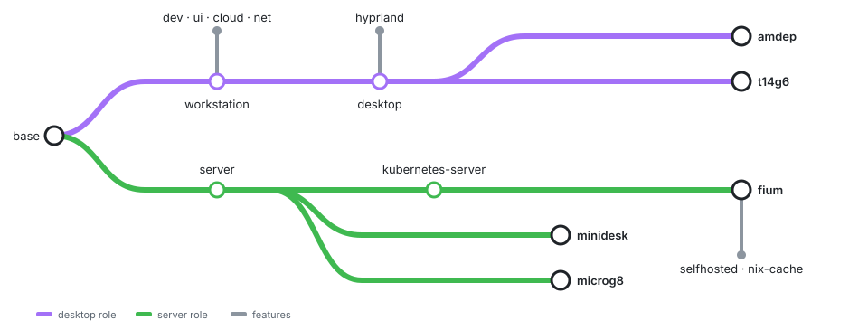

# NixOS configuration

[Hosts](#hosts) • [Structure](#structure) • [Usage](#usage) • [Herdr mods](#herdr-mods) • [Documentation](#documentation)

My NixOS desktops, servers, and development environment. Built on [nixos-unstable](https://github.com/NixOS/nixpkgs), [Home Manager](https://github.com/nix-community/home-manager), and [flake-parts](https://flake.parts/).

Desktops use Hyprland and DankMaterialShell. The repo also contains Neovim configuration, omp settings and skills, container tools, and self-hosted services.

> [!NOTE]
> This is a personal configuration, not a starter template. It targets `x86_64-linux`, uses the account `kevin`, and depends on private secrets and work configuration. Desktop settings expect a checkout at `~/nixos-config`.

## Hosts

| Host | Purpose |
| --- | --- |
| [`amdep`](modules/hosts/amdep.nix) | Hyprland desktop, dual-boot with Windows |
| [`t14g6`](modules/hosts/t14g6.nix) | ThinkPad T14 Gen 6 AMD, Hyprland desktop |
| [`fium`](modules/hosts/fium.nix) | Self-hosted services, storage, k3s, and the Nix binary cache |
| [`minidesk`](modules/hosts/minidesk.nix) | Development and work server |
| [`microg8`](modules/hosts/microg8.nix) | Server with Btrfs storage |
| [`installer`](modules/hosts/installer.nix) | Minimal installation ISO |

## Structure

[import-tree](https://github.com/vic/import-tree) loads the files under `modules/`. Features are named NixOS modules called **aspects**. Roles group aspects, and host entry points select the roles and features each machine needs.

<p align="center">
  
</p>

Hosts can also import individual features, such as `development` on `minidesk`.

| Path | Contents |
| --- | --- |
| [`flake.nix`](flake.nix) | Inputs and module loading |
| [`modules/nixos-configurations.nix`](modules/nixos-configurations.nix) | Host discovery and shared package set |
| [`modules/hosts/`](modules/hosts/) | Host entry points |
| [`modules/roles/`](modules/roles/) | Desktop, workstation, server, and Kubernetes server roles |
| [`modules/`](modules/) | Feature settings grouped by area |
| [`hosts/`](hosts/) | Hardware, disk layouts, and host-specific desktop files |
| [`hyprland/`](hyprland/) | Desktop configuration, DMS settings, plugins, and patches |
| [`themes/`](themes/) | Desktop theme palettes and wallpapers |
| [`neovim/`](neovim/) | Neovim Lua configuration and Nix wrapper |
| [`herdr/`](herdr/) | herdr settings, linked writable into `~/.config/herdr` |
| [`orca-slicer/`](orca-slicer/) | Orca Slicer printer, process, and filament presets, linked writable into its configuration |
| [`agents/`](agents/) | Harness-independent agent instructions and skills |
| [`omp/`](omp/) | omp settings, extensions, and commands |
| [`packages/`](packages/) | Local helper packages |
| [`lib/`](lib/) | Shared Nix helpers |
| [`scripts/`](scripts/) | Maintenance scripts that `just` runs |
| [`justfile`](justfile) | `just switch`, `just check`, and `just pins` |
| [`treefmt.nix`](treefmt.nix) | Formatters that `nix fmt` and the formatting check run |
| [`ci-dummy-input/`](ci-dummy-input/) | Stand-in for the private inputs in public CI |
| [`docs/`](docs/) | Documentation diagrams |

## Usage

```bash
just switch                  # build and activate the current host
just check                   # evaluate every host and run the flake checks
just pins                    # compare hand-made version pins with upstream
nix fmt                      # format the repository
nix build .#installer-iso    # build the installation ISO
```

Servers deploy `main` automatically with [Comin](modules/services/comin.nix). The cache host updates the flake inputs daily and pushes the lock only when every workstation builds. See [Applying changes](modules/README.md#applying-changes).

## Herdr mods

Workstations install [herdr-lazygit](https://github.com/kevinpita/herdr-lazygit) as a pinned Herdr desktop mod. A user service merges its shortcut into Herdr's writable key file after Herdr creates it and when it changes. Other bindings stay user-managed.

Workstations also install [herdr-app-hoverfocus](https://github.com/monorkin/herdr-app-hoverfocus), which focuses the pane under the pointer. It is a third-party mod, so `flake.nix` pins it to an audited commit and the daily input update leaves it alone. The mod works only in a layout that names it as its pane header. Layouts stay user-managed.

## Documentation

- [Install a machine](INSTALL.md): new hosts, reinstalls, secrets, and first-boot setup.
- [System configuration](modules/README.md): aspects, roles, and where a change belongs.
- [Machine-specific files](hosts/README.md): hardware and disk layouts.
- [Desktop configuration](hyprland/README.md), [Neovim](neovim/README.md), [agent instructions and skills](agents/README.md), [omp configuration](omp/README.md), and [local packages](packages/README.md).
- [Public CI](.github/workflows/nix-config-check.yml): checks with dummy private inputs.
