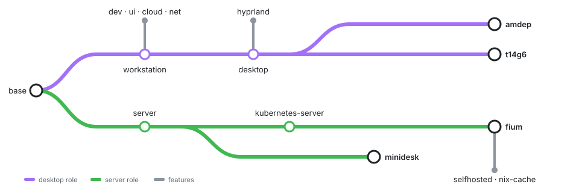

# NixOS configuration

My NixOS desktops, servers, and development environment. Built on [nixos-unstable](https://github.com/NixOS/nixpkgs), [Home Manager](https://github.com/nix-community/home-manager), and [flake-parts](https://flake.parts/).

Desktops use Hyprland and DankMaterialShell. The repo also contains Neovim configuration, Pi settings and skills, container tools, and self-hosted services.

This is a personal configuration, not a starter template. It targets `x86_64-linux`, uses the account `kevin`, and depends on private secrets and work configuration. Desktop settings expect a checkout at `~/nixos-config`.

## Hosts

| Host | Purpose |
| --- | --- |
| [`amdep`](modules/hosts/amdep.nix) | Hyprland desktop, dual-boot with Windows |
| [`t14g6`](modules/hosts/t14g6.nix) | ThinkPad T14 Gen 6 AMD, Hyprland desktop |
| [`fium`](modules/hosts/fium.nix) | Self-hosted services, storage, k3s, and the Nix binary cache |
| [`minidesk`](modules/hosts/minidesk.nix) | Development and work server |
| [`installer`](modules/hosts/installer.nix) | Minimal installation ISO |

## Structure

[import-tree](https://github.com/vic/import-tree) loads the files under `modules/`. Features are named NixOS modules called **aspects**. Roles group aspects, and host entry points select the roles and features each machine needs.

<p align="center">
  
</p>

Hosts can also import individual features, such as `development` on `minidesk`.

| Path | Contents |
| --- | --- |
| [`flake.nix`](flake.nix) | Inputs and module loading |
| [`modules/nixos-configurations.nix`](modules/nixos-configurations.nix) | Host discovery and shared package set |
| [`modules/hosts/`](modules/hosts/) | Host entry points |
| [`modules/roles/`](modules/roles/) | Desktop, workstation, server, and Kubernetes server roles |
| [`modules/`](modules/) | Feature settings grouped by area |
| [`hosts/`](hosts/) | Hardware, disk layouts, and host-specific desktop files |
| [`hyprland/`](hyprland/) | Desktop configuration, DMS settings, plugins, and patches |
| [`neovim/`](neovim/) | Neovim Lua configuration and Nix wrapper |
| [`pi/`](pi/) | Pi skills, prompts, themes, and maintenance files |
| [`packages/`](packages/) | Local helper packages |
| [`lib/`](lib/) | Shared Nix helpers |
| [`justfile`](justfile) | `just switch` to build and activate the current host |

## Usage

```bash
just switch                  # build and activate the current host
nix fmt                      # format the repository
nix build .#installer-iso    # build the installation ISO
```

Servers deploy `main` automatically with [Comin](modules/services/comin.nix). The cache host updates the flake inputs daily and pushes the lock only when every workstation builds. See [Applying changes](modules/README.md#applying-changes).

## Documentation

- [Install a machine](INSTALL.md): new hosts, reinstalls, secrets, and first-boot setup.
- [System configuration](modules/README.md): aspects, roles, and where a change belongs.
- [Machine-specific files](hosts/README.md): hardware and disk layouts.
- [Desktop configuration](hyprland/README.md), [Neovim](neovim/README.md), [Pi configuration](pi/README.md), and [local packages](packages/README.md).
- [Public CI](.github/workflows/nix-config-check.yml): checks with dummy private inputs.
