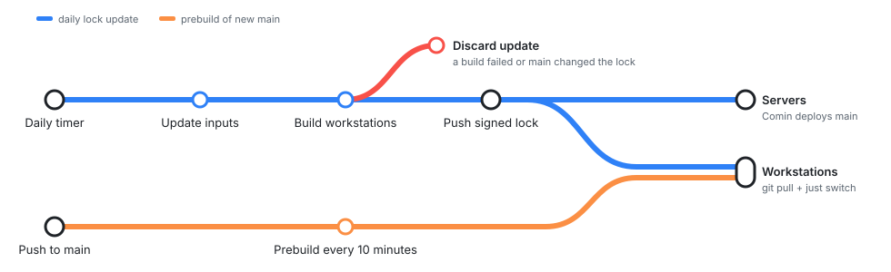

# System configuration

This is where NixOS and Home Manager settings are connected to machines. Change this folder when a feature needs packages, services, permissions, generated settings, or a different set of hosts. Application source and writable desktop preferences belong in their own top-level folders.

## How the pieces fit

`import-tree` loads Nix files below this directory as flake modules. Each named entry in `flake.modules.nixos` is an **aspect**. An aspect can be a feature, a role, or a host. Several files can contribute to the same aspect without importing each other.

- `hosts/<hostname>.nix` selects a machine's hardware files, roles, and additional features. Put a machine-only exception here rather than changing a shared default.
- `roles/` groups features. `desktop` includes `workstation` plus Hyprland. `server` provides the shared server environment. Add an aspect to a role when every machine with that role should receive it. Each role adds its name to `host.roles`, and `hostsWithRole "<role>"` returns the matching host names. Use it instead of listing hosts by hand.
- Feature files define the settings themselves. Extend the existing aspect when the behavior belongs to it. Create a new aspect when it needs to be selected independently.

A new file is discovered automatically, but a new aspect must still be selected by a host or role. Do not add manual imports to `flake.nix`, and do not add another import just because a second file contributes to an existing aspect. Raw NixOS helper modules belong outside this directory.

## Where a change belongs

| Area | Change it for |
| --- | --- |
| `base/` | Shared accounts, secrets, boot defaults, networking, shell, and system tools |
| `dev/` | Development tools, Git, editors, and AI clients |
| `cloud/` | Cloud, cluster, and container tools |
| `net/` | Remote access and file sharing |
| `ui/` | Desktop applications and shared UI settings |
| `hyprland/` | Desktop session setup, DMS integration, plugin installation, and desktop helper services |
| `selfhosted/` | Hosted services, monitoring, alerts, dashboards, and storage integration |
| `virtualization/` | Virtual machines and system containers |
| `misc/` | Private work integration and specialized features that do not fit another category |
| `neovim.nix` | Wiring the [Neovim package](../neovim/README.md) into system and flake outputs |
| `omp.nix` | omp package, wrapper settings, and deployed files. Other aspects add omp skills and MCP servers through `omp.pluginDirs`. |

The folder name does not decide which machines receive settings. The aspect name and its callers do. A file can define a feature or contribute directly to an existing role.

## Shared wiring

`nixos-configurations.nix` discovers aspects named `hosts/<hostname>` and creates their NixOS outputs. It also owns the shared username, architecture, package overlays, and common module integration. Change it for system-wide construction rules, not individual host preferences.

`packages.nix` exposes local helpers as flake packages. Defining a package there does not install it on a host. The feature that uses it owns installation and service configuration.

Private work modules and encrypted secrets come from flake inputs. Change those repositories for their contents, then update the relevant lock entry here. Do not put credentials in public modules.

## Applying changes

Run `nix fmt` from the repository root. `just switch` builds and activates the current host. A change to a shared aspect affects every host that imports it when that host is rebuilt. Keep existing `stateVersion` values unchanged during routine updates.

The cache host updates all flake inputs on top of `main` once a day and builds every workstation with them. When every build passes, it pushes a signed `flake.lock` commit to `main`. Comin then deploys that update to the servers. On a workstation, run `git pull` and `just switch` to get it. Packages download from the cache only when their build inputs match what the cache host built, so local module changes that are not on `main` can still build locally, for example a change to the omp wrapper in `omp.nix`. Run `update-git` for an immediate update. Inputs that moved since the last cache host run build locally. After you push that commit, the cache host builds the new `main` for the other workstations within about 10 minutes. The cache host's checkout always resets to the remote `main`, including after a force push. If `main` moves during its builds, it puts the built lock on top of the new `main`. If the new `main` has a different `flake.lock`, it discards its own update.

  

