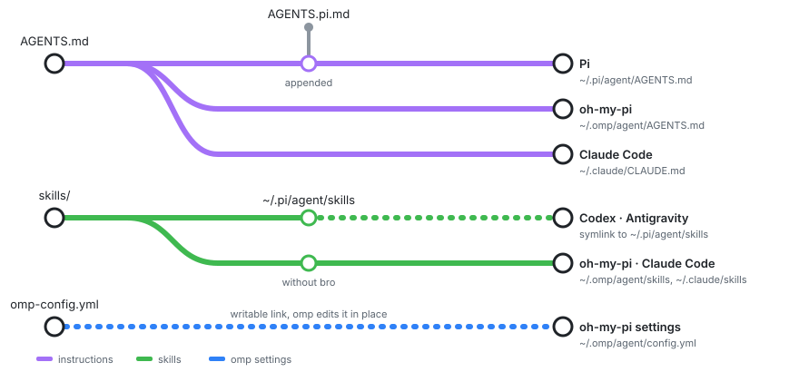

# Pi configuration

This folder owns the Pi configuration content shipped with these systems. It is not the Pi runtime source or the main extension repository. `modules/pi.nix` selects the runtime, extensions, npm packages, generated settings, and files installed into `~/.pi/agent/`.

## What belongs here

| Path | Change it for |
| --- | --- |
| `AGENTS.md` | Harness-neutral instructions deployed to Pi (`~/.pi/agent/AGENTS.md`), oh-my-pi (`~/.omp/agent/AGENTS.md`), and Claude Code (`~/.claude/CLAUDE.md`). Keep tool and agent names out of this file. Project-specific rules belong in the relevant project's instruction file. |
| `omp-config.yml` | oh-my-pi settings shared by all hosts. `~/.omp/agent/config.yml` links to this file, so settings changes in omp edit it in place. Commit and pull to share them. |
| `AGENTS.pi.md` | Pi-only instructions, such as Pi tool and subagent names. `modules/pi.nix` appends it to the shared file for Pi only. |
| `omp-agents/` | oh-my-pi worker definitions deployed to `~/.omp/agent/agents`. Their `model` frontmatter selects a role from `omp-config.yml`. |
| `skills/` | Reusable task guidance and its supporting references, also deployed to oh-my-pi (`~/.omp/agent/skills`), Claude Code, Codex, and Antigravity. Extend the existing skill when it already owns the task. |
| `prompts/` | Reusable prompt text for tasks the user starts explicitly |
| `themes/` | Pi color themes. The selected theme is set in `modules/pi.nix`. |
| `scripts/` | Session maintenance code packaged and scheduled through Nix |

The skills, prompts, and themes directories are deployed as directories. Keep shared skill content here rather than duplicating it for each configured client. oh-my-pi and Claude Code get the skills without `bro`, because pstack ships its own.

  

## Model routing

`omp-config.yml` owns model assignments and reasoning effort. The `task` role selects the model for generic task workers. `task.agentModelOverrides` assigns models to bundled specialists without copying their prompts. Custom workers select roles through their `model` frontmatter.

A session model switch does not change explicit worker assignments. Role aliases resolve at use time. An alias to `@default` can follow a session model switch, so use an explicit selector when a worker must stay on one model.

Keep providers available for manual selection when only their default routes change. Provider blocks belong in `modules/pi.nix`, separate from role assignments. Web search and local voice roles keep the runtime defaults.

## Configuration or extension code?

Change `modules/pi.nix` for defaults, package selection, extension settings, or which files are installed. Change this folder for the content of those files. Changes to the main custom extensions belong in `~/nixos-pi`, consumed through the `pi-extensions` flake input. The `pi-flake` input provides the Pi runtime and `oh-my-pi` provides omp. The `pstack` input pins the pstack plugin that omp loads; Claude Code installs its own copy from its marketplace.

For local extension development, override `pi-extensions` with `path:$HOME/nixos-pi` in a check or build. For normal deployment, publish the extension changes and update that flake input. A local clone alone does not change what the locked configuration installs.

## Applying changes

Run `just switch` from the repository root to deploy Nix-managed changes, then restart Pi or omp to load them. Edit the source here rather than generated or linked files under `~/.pi/agent/` or `~/.omp/agent/`. Prompt filenames become their command names, so rename them only when the user-facing command should change.

Session history, authentication, caches, and generated artifacts are runtime data, not configuration to commit here. The session-maintenance script can archive and remove old sessions, so changes to its retention behavior need particular care.
